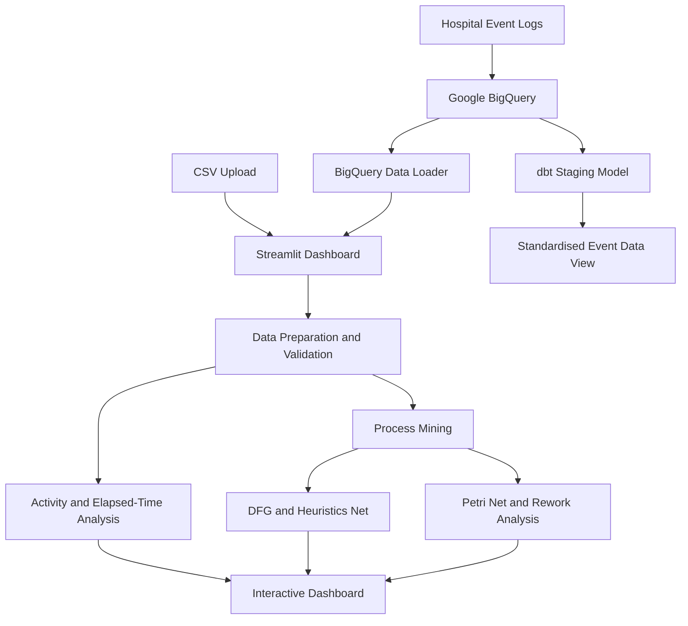

# CareFlow - Clinical Pathway Process Mining

CareFlow is a healthcare process-mining project designed to analyse hospital event logs and understand how patients move through different stages of a clinical pathway.

The project combines data preparation, data quality checks, elapsed-time analysis, and process-mining techniques with an interactive Streamlit dashboard. It helps identify frequently occurring activities, transitions, and possible workflow bottlenecks.

## Live Dashboard

**Application:** https://careflow-analytics.streamlit.app/

## Problem Statement

Traditional hospital dashboards often focus on overall averages. These averages may hide repeated activities, delays between workflow stages, and variations in patient pathways.

CareFlow aims to make hospital workflow data easier to explore by analysing event sequences and elapsed time between consecutive recorded activities.

## Project Objectives

- Analyse hospital event logs at the patient-case level.
- Standardise and validate event data.
- Explore activity frequencies and workflow transitions.
- Calculate elapsed time between consecutive recorded events.
- Discover process models using PM4Py.
- Identify repeated activities and potential rework.
- Present findings through an interactive dashboard.

## Technology Stack

| Technology | Purpose |
|---|---|
| Python | Data processing and application logic |
| Streamlit | Interactive dashboard |
| Pandas | Data manipulation |
| Plotly | Interactive charts |
| Google BigQuery | Event-log storage and querying |
| dbt | Data transformation and staging |
| PM4Py | Process mining |
| PyVis | Interactive process visualisation |
| SQLite | Local user account storage |

## System Architecture



**Note:** The dashboard currently loads data directly from BigQuery or a CSV upload. The dbt staging model is a separate transformation component and is not currently the dashboard's data source.

## Dataset Overview

The project uses a hospital event-log dataset stored in Google BigQuery.

**BigQuery table:**

`careflow-analytics-98234.careflow_analytics.event_logs`

Dataset statistics:

| Metric | Value |
|---|---:|
| Total events | 200,004 |
| Total cases | 28,737 |
| Average events per case | 6.96 |

Important fields include:

- `event_id` – Unique event identifier.
- `case_id` – Identifier for a patient encounter.
- `activity` – Recorded workflow activity.
- `timestamp` – Date and time of the event.
- `department` – Department associated with the event.
- `event_sequence` – Event order information.
- `resource_role` – Role associated with the event.
- `resource_id` – Resource identifier.
- `event_detail` – Additional event information.
- `arrival_mode` – Recorded arrival mode.

## Dashboard Features

The Streamlit application provides multiple analysis sections.

### 1. Overview

- Displays key dataset metrics.
- Provides an overview of recorded activities.
- Summarises workflow information.

### 2. Activity Analysis

- Examines activity frequency.
- Displays activity-level summaries.
- Helps understand which activities occur most frequently.

### 3. Elapsed-Time Analysis

- Calculates elapsed time between consecutive events.
- Displays average, median, and maximum elapsed time.
- Identifies transitions with higher mean elapsed time.
- Provides transition-level statistics and downloadable results.

### 4. Data Quality

- Supports inspection of the loaded event sample.
- Helps identify missing or invalid values.
- Provides visibility into the prepared dataset.

### 5. Process Mining

The process-mining section includes:

- Directly-Follows Graph (DFG).
- Heuristics Net.
- Petri Net visualisation.
- Interactive Pathway Map.
- Rework Analysis.
- Patient Timeline.

These features help explore the order of activities, repeated workflow steps, and differences in recorded pathways.

### 6. Data Sources and Controls

- CSV file upload.
- Google BigQuery connection.
- Configurable sample limits of 200, 500, and 1,000 rows.
- User sign-up and login.

## Data Processing Workflow

The application prepares event data before analysis:

1. Loads event records from the selected source.
2. Validates required fields.
3. Handles missing or invalid records.
4. Converts timestamps into datetime values.
5. Standardises identifiers and activity values.
6. Sorts events by case and timestamp.
7. Identifies the previous activity within each case.
8. Calculates elapsed time between consecutive events.
9. Prepares transition information for visualisation and analysis.

## Data Quality and Analysis Report

The repository includes `data_quality_report.md`, which records a full-dataset analysis.

Reported results include:

| Metric | Result |
|---|---:|
| Non-negative elapsed intervals | 171,267 |
| Distinct transition types | 27 |
| Mean elapsed time | 28.86 minutes |
| Median elapsed time | 20.18 minutes |
| Maximum elapsed time | 240 minutes |

**Important interpretation:** These values represent elapsed time between consecutive recorded events. They should not automatically be interpreted as actual patient waiting time or clinical delay.

Full-dataset report statistics may differ from dashboard results because the dashboard can analyse a limited sample.

## dbt Transformation

The dbt project is located in `careflow_dbt/`.

The staging model `stg_event_logs` is designed to:

- Standardise event and case identifiers.
- Trim activity values.
- Safely convert timestamps.
- Replace blank department values with `Unknown`.
- Retain relevant workflow attributes.

The model is configured as a BigQuery view.

`dbt parse` completed successfully. Execution and data tests still require successful BigQuery access; the attempted test execution encountered a BigQuery permission error. Therefore, successful deployment of the staging view has not been confirmed.

## Project Structure

```text
CareFlow-Clinical-Pathway/
│
├── careflow_dbt/
│   ├── models/
│   │   └── staging/
│   │       ├── schema.yml
│   │       └── stg_event_logs.sql
│   ├── dbt_project.yml
│   └── README.md
│
├── dashboard/
│   ├── app.py
│   ├── auth.py
│   ├── bigquery_data.py
│   └── bigquery_test.py
│
├── src/
│   └── waiting_time_analysis.py
│
├── data_quality_report.md
├── pipeline_audit_report.md
├── requirements.txt
└── README.md
```

## Installation and Setup

### 1. Clone the repository

```bash
git clone https://github.com/Vishweswarann/CareFlow-Clinical-Pathway.git
cd CareFlow-Clinical-Pathway
```

### 2. Install dependencies

```bash
pip install -r requirements.txt
```

### 3. Configure BigQuery

Configure valid Google Cloud BigQuery credentials using the application's supported authentication configuration.

Do not commit service-account JSON files, credentials, passwords, or other secrets to GitHub.

### 4. Run the dashboard

```bash
streamlit run dashboard/app.py
```

### 5. Use CSV data

Alternatively, select CSV Upload in the dashboard and upload an event-log file containing the required fields:

- `case_id`
- `activity`
- `timestamp`

## dbt Commands

Run these commands from the repository root after configuring the dbt profile:

```bash
dbt debug --project-dir careflow_dbt --profiles-dir ~/.dbt
```

```bash
dbt parse --project-dir careflow_dbt --profiles-dir ~/.dbt
```

```bash
dbt run --project-dir careflow_dbt --profiles-dir ~/.dbt
```

```bash
dbt test --project-dir careflow_dbt --profiles-dir ~/.dbt
```

Successful execution requires working BigQuery connectivity and the necessary permissions.

## Reports and Documentation

- `data_quality_report.md` – Full-dataset data quality and elapsed-time findings.
- `pipeline_audit_report.md` – Pipeline audit and implementation evidence.
- `careflow_dbt/README.md` – dbt project documentation.

## Limitations

- Dashboard analysis may use a limited sample rather than the entire dataset.
- Elapsed time between events is not necessarily equivalent to patient waiting time.
- Process-mining results depend on the event records available and their ordering.
- dbt model deployment and tests remain subject to BigQuery access.
- Findings should be interpreted as workflow analysis, not as clinical recommendations.

## Project Goal

CareFlow aims to make hospital workflow data more understandable through data engineering, process mining, and interactive visualisation. By exploring recorded patient pathways and transitions, the project provides a foundation for identifying areas that may require further operational investigation.
